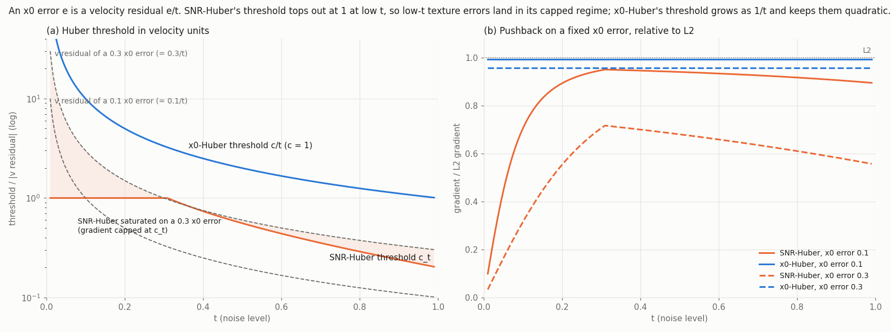
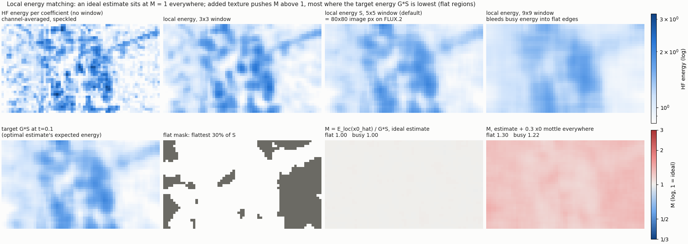

# Flat-region mottle and the x0-unit Huber threshold

Status as of 2026-09-28. **x0-Huber works and is the default going forward.** It was tested on FLUX.2 Klein
and on Krea 2. Local energy matching is implemented but hasn't been trained yet.

## The problem

DiT LoRA training with `WaveletPlusSNRHuber` (Krea 2, FLUX.2 Klein) left low-amplitude high-frequency
texture ("mottle", "resonations") in flat regions: plain backgrounds, skies, studio walls. On the FLUX.2 control
run it appeared between steps 500 and 1000 and kept growing.

## What changed

| where | change |
|---|---|
| `wavelet_loss.x0_threshold_huber_loss` | new: pseudo-Huber on the velocity residual, with the threshold measured in x0 units |
| `WaveletLoss(use_x0_huber=True, x0_huber_c=1.0)` | the same loss per wavelet band. Needs `timestep`, and can't be combined with `use_snr_aware_huber` |
| `wavelet_loss.musubi.WaveletPlusX0Huber` | musubi adapter: x0-Huber main term (`main_x0_huber_c`) plus the wavelet term (`loss_type='x0_huber'` makes the bands use it too) |
| `wavelet_loss.local_energy` | new: local HF energy matching (`energy_beta`) and the mottle ratio M (`mottle_metrics`) |
| musubi adapters | x0_hat reconstructed from the stashed `noisy_model_input`. Also fixes the `weighting` broadcast for 5D latents |
| boo-musubi-tuner `loss_context` trainers | **the new trainer format**: FLUX.2 / Krea 2 trainers that stash `noisy_model_input`, `latents` and `noise` in `DiTOutput.extra`. The loss still comes from `--loss_fn`, so any loss can use x0_hat without its own trainer. See boo-musubi-tuner `docs/loss-context.md` |

The x0-Huber loss alone needs only `pred`, `target` and `timesteps`, so it runs on the stock trainers too.
`energy_beta`, `mottle_metrics` and `rectified_flow=True` need the `loss_context` trainers.

## Why SNR-Huber lets mottle through

Flow matching (musubi's convention, `t` = sigma in [0, 1]):

```
x_t    = (1 - t) x0 + t eps
v      = eps - x0                    (the training target)
x0_hat = x_t - t v_hat
=> x0_hat - x0 = -t (v_hat - v)      an x0 error e is a velocity residual e / t
```

Mottle is an x0 error: small texture, e ≈ 0.03–0.3 in latent units. It is formed at low `t`, the last
denoising steps, where the image's fine detail is decided. There `e / t` is large: 0.3 of x0 texture at
t = 0.05 is a velocity residual of 6.

SNR-Huber (`snr_aware_huber_loss`, UltraFlux) is a pseudo-Huber on the velocity residual:

```
rho(r) = c_t^2 (sqrt(1 + (r / c_t)^2) - 1)      gradient -> c_t once |r| >> c_t
c_t    = cmin + (cmax - cmin) (min(SNR, gamma) / gamma)^alpha,   SNR = (1 - t)^2 / t^2
```

With the defaults (cmin 0.2, cmax 1, gamma 5) `c_t` is at most 1, and it is exactly 1 for every
t ≤ 0.31. That is where SNR ≥ 5 and the clamp takes over. At low `t` the residual of ordinary texture
errors is therefore far past the threshold, and the loss treats it as an outlier: the gradient pushing it back
is capped at 1 no matter how large it is. The Huber was meant to be robust to noisy high-`t` targets.
In velocity units it also makes the loss robust to exactly the low-`t` texture errors that become mottle.

Verified on real FLUX.2 latents (bojack / mist, SWT sym7 level 2):

- the SNR-Huber band loss gives **2.5–3.9× weaker pushback than L2** on flat-region mottle at t = 0.05;
- it recovers only as `t` rises.

## Why x0-Huber fixes it

Measure the threshold in x0 units instead: threshold `c` on the x0 error, i.e. `c / t` on the velocity
residual.

```
rho(r) = (c/t)^2 (sqrt(1 + (r t / c)^2) - 1)  =  r^2 / (sqrt(1 + (r t / c)^2) + 1)
```

The second form is the implemented one: it is numerically stable as `t -> 0`, and `t` is clamped at 1e-3.

- **Quadratic while the x0 error is below `c`, at every `t`:** `rho ≈ r^2 / 2`, plain L2, so mottle-sized
  errors get full L2 pushback. On the same latents the c/t threshold restores **91–100% of L2 pushback**.
- **Robust once the x0 error exceeds `c`:** the gradient is bounded at `c / t`. The outlier protection
  is kept, but judged by how wrong the image is rather than how large the velocity residual is.
- **High `t` is unchanged in spirit:** there `c / t ≈ c`, a v-space Huber much like SNR-Huber's.

`c = 1.0` is about the size of a whole latent coefficient: generous for texture, still bounded for gross
errors. Tests: `tests/test_x0_huber.py` covers parity with pseudo-Huber at c/t in float64, the quadratic
regime, the bounded gradient, and `c -> inf` equals L2/2.



**(a)** Each loss's threshold in velocity units, against the velocity residual a fixed x0 error produces
(dashed). Where a dashed line is above a threshold, that loss is saturated for that error (shaded for
SNR-Huber on a 0.3 error). SNR-Huber's threshold is flat at 1 up to t ≈ 0.31 while the residual grows as
1/t. x0-Huber's threshold grows with it.

**(b)** Gradient on that error relative to L2's:

| loss | x0 error 0.1 | x0 error 0.3 |
|---|---|---|
| SNR-Huber, t = 0.05 | 0.45 | 0.16 |
| SNR-Huber, t = 0.3 | 0.95 | 0.71 |
| x0-Huber, any t | 0.995 | 0.96 |

The residual here is a single deterministic coefficient. The 2.5–3.9× numbers above are the fuller version,
measured with the irreducible noise residual on real latents.

Regenerate: `uv run python scripts/visualize_x0_huber.py [--latent latents.safetensors --key bojack]`.

### Why not reweight instead

The derivation ruled out the other levers before any training run:

- **Per-band or per-location weights `w(r, t)`**, e.g. weighting bands by local noise and timestep. A
  weight scales both the mottle signal and the irreducible noise at a location. So it can move effort
  between locations but can't change how well a location's gradient tells mottle from noise.
- **Lowering `c`**, SNR-Huber's lever. For Gaussian residuals the pseudo-Huber efficiency is
  `E[psi']^2 V / E[psi^2] ≤ 1`, with equality only as `c -> inf` (L2). A smaller `c` can only lower that
  signal-to-noise.
- **Plain L2 already has no mottle at its optimum:** `E[L2 | mu] = V + mu^2 / t^2`. So mottle comes from
  weak or noisy restoring force during optimisation, not from a biased target. The fix is restoring the
  force, which is what x0-Huber does.

## Local energy matching and the 5x5 window (implemented, not yet trained)

A per-coefficient loss asks "is each coefficient right?". Mottle is better described as "there is too much
texture here". `local_energy.py` checks that directly.

**Target.** Model each HF wavelet band locally as Gaussian with local x0 energy `S`. The ideal
(posterior-mean) estimate at noise level `t` is a Wiener-shrunk version of the noisy signal, and its
expected energy is

```
G S,   G = S / (S + N'),   N' = t^2 / (1 - t)^2      (noise energy in x0 units)
```

The ideal estimate is *smoother* than x0 (G < 1). So the right target is `G S`, not `S`. Matching `S`
would ask for mottle at high `t`. These closed forms match real FLUX.2 latents within 0.2–6%
(t = 0.05–0.5). SWT sym7 bands of unit white noise have unit variance, which is what makes `N'` exact.

**Loss.** Summed over HF bands (lh, hl, hh) and levels, weighted by the wavelet timestep fade:

```
(log(E_loc(x0_hat) + eps) - log(G S + eps))^2
```

- `G S` is computed from the clean latent under `no_grad`.
- `t` is clamped at 0.95 because `N'` diverges at t = 1.
- The log makes the term scale-free: it penalises the *ratio* of energies, so a flat region at 3× its
  target energy counts as much as a busy region at 3×.

**Why a window at all, and why 5x5.** One coefficient's squared value is a one-sample energy estimate. It is
χ²-noisy, and a loss on it is just a per-coefficient loss again. `E_loc` averages `x^2` over a `window x window`
box (reflect-padded) and over all channels.

- **Channel averaging** does most of the variance reduction. Per-channel energy correlates only 0.3–0.5
  with the truth; channel-averaged, 0.91–0.98.
- **The box** sets the spatial resolution of "here". It is the trade-off in the top row of the figure:
  - 1x1 (no window) is speckle;
  - 3x3 still follows individual coefficients;
  - 9x9 smears busy energy across flat edges, so a flat region next to detail looks busy and its mottle
    is hidden;
  - 5x5 separates flat and busy regions while staying stable.
- **Scale:** on FLUX.2 a latent cell is 16x16 image px (VAE /8 plus 2x2 patchify), so 5x5 covers 80x80
  px. That is about the size of the flat patches where mottle is visible.

`energy_window` (default 5) changes it on the musubi adapters.

**Metric.** `mottle_ratio` gives M = `sum E_loc(x0_hat) / sum G S`, pooled over the flattest 30% of the
image (level-1 HF energy of x0) and over the busy remainder:

- M ≈ 1: ideal;
- M > 1: mottle;
- M < 1: over-smoothed.

`mottle_metrics=True` logs `mottle/M_{flat,busy}_{t00-20,t20-50,t50-100}`. M depends strongly on `t`, so it
is bucketed.



The figure uses a real FLUX.2 latent, SWT level 1, t = 0.1. The ideal estimate, simulated in the band
domain, sits at M = 1.00 in both regions, which confirms the `G S` target. Adding 0.3 of x0 texture
everywhere gives:

- flat M = 1.30, busy M = 1.22;
- the same texture reads higher in flat regions because their target energy is lower.

FLUX.2 flat regions still carry about 0.3 of the noise floor's HF energy, so the flat/busy gap is modest on
real latents. On the synthetic latent (near-zero flat energy) the same texture reads M ≈ 20.

## Experiment log

The FLUX.2 runs are FLUX.2 Klein 4B on the retro-anime set, in `~/code/training_runs/retro-anime-mottle-*`.
They share:

- lr 1e-4, dim 8, batch 1, max_grad_norm 1, flux2_shift 3;
- SWT sym7 level 2 with LL weight 0; XM off.

| run | model / optimizer / scale | loss | result |
|---|---|---|---|
| `4b57be73` | FLUX.2, RAdam, alpha 16 (x2), loraplus 8 | SNR-Huber | collapsed by step 1000. The LoRA had no outlier tensors. |
| `b3ebab42` (wandb `xzxa7ydz`) | FLUX.2, AdamW, x2, loraplus 8 | SNR-Huber | wobble at 1000, good at 1500. Clay-background mottle 0.31 → 1.08 → 1.26 at steps 500/1000/1500. Stopped at 1513. |
| `b92c40f0` (wandb `r7ntkvri`) | FLUX.2, AdamW, x2, loraplus 8 | **x0-Huber** (`c=1`, alpha 1.0) | 2000 steps. Clay background 1.01 → 1.45 → 0.61 → 0.38. Quality comparable or better, judged "surprisingly good". |
| `eda0bd1f` (wandb `d4a05zde`) | **Krea 2**, AdamW, x2, loraplus 8, krea2_shift | **x0-Huber** via `krea2_train_network_loss_context.py` | 2000 steps; works (user test run). Excludes first/last/tmlp/tproj/txtfusion.projector from the LoRA (see `retro-anime-krea-2` notes). |

The mottle number is the std (gray levels) of `image - 5x5 box blur` on the clay prompt's background crop
`(20, 20, 220, 220)`. Composition changes between checkpoints make per-sample numbers noisy. An
all-prompt automatic flat mask was inconclusive for the same reason.

In-training M for `r7ntkvri` does not drift upward over training:

- t < 0.2: M_flat ≈ 1.00–1.02, but only 11 samples.
- t 0.2–0.5: M_flat ≈ 1.3 vs M_busy ≈ 1.25.

shift 3 rarely samples t < 0.2, which is where mottle forms.

### Config used (FLUX.2 treatment)

```toml
loss_fn = "wavelet_loss.musubi.WaveletPlusX0Huber"
loss_fn_args = [
  "alpha=1.0",
  "main_x0_huber_c=1.0",   # main-term threshold, x0 units
  "loss_type='x0_huber'",  # band loss
  "x0_huber_c=1.0",        # band threshold, x0 units
  "transform_type='swt'", "wavelet='sym7'", "level=2",
  "band_weights={'ll': 0.0, 'lh': 1.0, 'hl': 1.0, 'hh': 1.0}", "ll_level_threshold=2",
  "metrics=True", "rectified_flow=False",
  "mottle_metrics=True",   # needs the loss_context trainer
]
# training_script = src/boo_musubi_tuner/loss_context/flux_2_train_network_loss_context.py
```

## Next

1. Offline M on fixed images, noise and t ∈ [0.05, 0.3] for the step 500/1000/1500 checkpoints of the
   FLUX.2 runs. This gives a like-for-like comparison, including the control, which never logged M.
2. "Work backwards" from x0-Huber:
   - gentler scale (the `retro-anime-mottle-control` config now holds alpha 8 = x1, loraplus 4);
   - then `energy_beta` if mottle remains.
3. Explorative Modeling doesn't compose with the wavelet adapters yet. XM calls
   `compute_loss(reduction="none")`, and the adapters only return a scalar.
