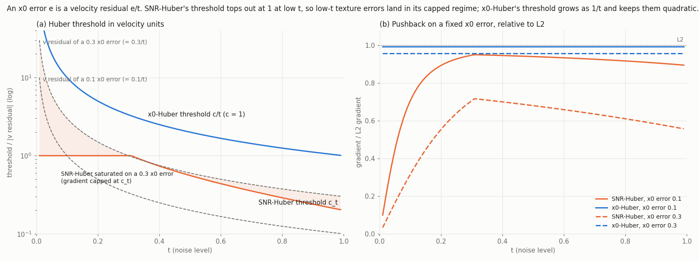
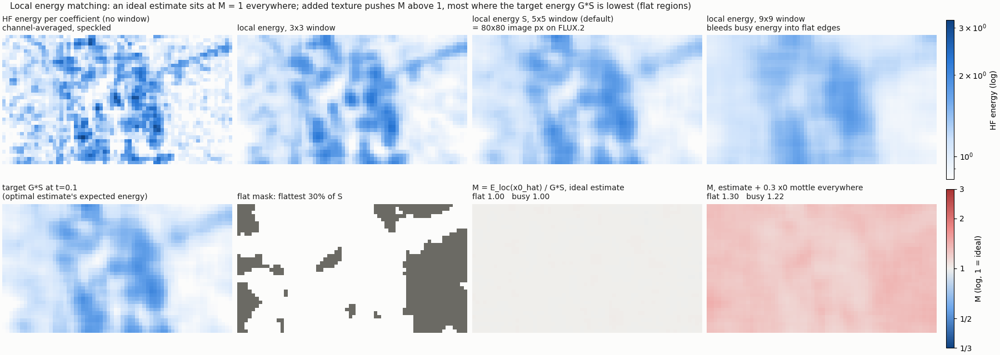

# x0-Huber and local energy matching

Two loss components for flow-matching training, plus a metric:

- **x0-Huber**: a pseudo-Huber on the velocity residual whose threshold is measured in x0 (clean-latent)
  units. It is quadratic for small image errors at every timestep.
- **Local energy matching**: compares the local high-frequency energy of the model's x0 estimate with
  what an ideal estimate would have. It penalises extra texture painted into flat regions.
- **Mottle ratio M**: the same energy comparison, as a metric.

## x0-Huber

### What it is

Flow matching (`t` = sigma in [0, 1]):

```
x_t    = (1 - t) x0 + t eps
v      = eps - x0                    (the training target)
x0_hat = x_t - t v_hat
=> x0_hat - x0 = -t (v_hat - v)      a velocity error r is an x0 error e = t r
```

**x0** is the clean latent. A plain velocity-space Huber sets its threshold on `r`. x0-Huber sets it on `e`:
the threshold asks whether the implied clean latent is off by more than `c`. At low `t` those are very
different questions. An x0 error of 0.3 at t = 0.05 is a velocity error of 6.

```
rho(r) = (c/t)^2 (sqrt(1 + (r t / c)^2) - 1)  =  r^2 / (sqrt(1 + (r t / c)^2) + 1)
```

The second form is the implemented one. It is stable as `t -> 0`, and `t` is clamped at `t_min = 1e-3`.
Written in x0 units:

```
rho = (1 / t^2) * c^2 (sqrt(1 + (e / c)^2) - 1)
```

That is an ordinary pseudo-Huber on the x0 error with threshold `c`, weighted by `1 / t^2`. That weight is
the same factor that makes L2 on x0 equal L2 on velocity. So:

- **x0 error below `c`:** `rho ≈ r^2 / 2`, i.e. plain velocity L2, at every `t`.
- **x0 error above `c`:** the gradient is bounded at `c / t`. Outliers are judged by how wrong the image is,
  not by how large the velocity residual is.
- **High `t`:** `c / t ≈ c`, so it behaves like an ordinary velocity Huber.

The loss is still computed on the velocity prediction. "x0" names where the threshold lives.

### Compared with SNR-Huber

SNR-Huber (`snr_aware_huber_loss`) sets a velocity-space threshold from the SNR:

```
c_t = cmin + (cmax - cmin) (min(SNR, gamma) / gamma)^alpha,   SNR = (1 - t)^2 / t^2
```

With the defaults (cmin 0.2, cmax 1, gamma 5) `c_t` never exceeds 1, and it is exactly 1 for all t ≤ 0.31.
At low `t`, small x0 errors become large velocity residuals, land past the threshold, and get a capped
gradient. x0-Huber's threshold `c / t` grows with the residual instead.



**(a)** Each loss's threshold in velocity units, against the velocity residual that a fixed x0 error
produces (dashed). Where a dashed line is above a threshold, that loss is saturated for that error.

**(b)** Gradient on a fixed x0 error, relative to L2:

| loss | x0 error 0.1 | x0 error 0.3 |
|---|---|---|
| SNR-Huber, t = 0.05 | 0.45 | 0.16 |
| SNR-Huber, t = 0.3 | 0.95 | 0.71 |
| x0-Huber (c = 1), any t | 0.995 | 0.96 |

On real FLUX.2 latents (SWT sym7 level 2), the SNR-Huber band loss gives 2.5–3.9× weaker pushback than L2
on small flat-region texture errors at t = 0.05. x0-Huber restores 91–100%. That measurement includes the
irreducible noise residual.

### Usage

```python
from wavelet_loss import WaveletLoss, x0_threshold_huber_loss

# element-wise, unreduced
loss = x0_threshold_huber_loss(pred, target, timestep, max_timestep=1000.0, c=1.0).mean()

# per wavelet band
loss_fn = WaveletLoss(transform_type="swt", wavelet="sym7", level=2,
                      use_x0_huber=True, x0_huber_c=1.0, max_timestep=1000.0)
loss, metrics = loss_fn(pred, target, timestep)   # timestep is required
```

- `use_x0_huber` and `use_snr_aware_huber` are mutually exclusive.
- `c` is in absolute latent units. `c = 1.0` suits FLUX.2; see [Latent scale](#latent-scale) for other VAEs.

musubi-tuner (`--loss_fn`):

```toml
loss_fn = "wavelet_loss.musubi.WaveletPlusX0Huber"
loss_fn_args = [
  "alpha=0.2",             # wavelet term weight (see Tuning)
  "main_x0_huber_c=1.0",   # main-term threshold, x0 units
  "loss_type='x0_huber'",  # band loss
  "x0_huber_c=1.0",        # band threshold, x0 units
  "transform_type='swt'", "wavelet='sym7'", "level=2",
  "band_weights={'ll': 0.0, 'lh': 1.0, 'hl': 1.0, 'hh': 1.0}",
]
```

x0-Huber needs only `pred`, `target` and `timesteps`, so it runs on the stock trainers.

## Local energy matching

`wavelet_loss.local_energy`. A per-coefficient loss asks whether each coefficient is right. This term asks
whether there is the right *amount* of high-frequency texture in each neighbourhood.

### Target

Model each HF wavelet band locally as Gaussian with local x0 energy `S`. The ideal (posterior-mean)
estimate at noise level `t` has expected energy

```
G S,   G = S / (S + N'),   N' = t^2 / (1 - t)^2      (noise energy in x0 units)
```

The ideal estimate is smoother than x0 (`G < 1`), so the target is `G S`, not `S`. These closed forms match
real FLUX.2 latents within 0.2–6% for t = 0.05–0.5. SWT sym7 bands of unit white noise have unit
variance, which is what makes `N'` exact.

### Loss

Summed over HF bands (lh, hl, hh) and levels, weighted by the wavelet timestep fade:

```
(log(E_loc(x0_hat) + eps) - log(G S + eps))^2
```

- `G S` is computed from the clean latent without gradient.
- `t` is clamped at 0.95, because `N'` diverges at t = 1.
- The log compares energy *ratios*, so a flat region at 3× its target counts as much as a busy region at 3×.

### The window

`E_loc` averages `x^2` over a `window x window` box (reflect-padded) and over all channels. One squared
coefficient is a one-sample energy estimate, far too noisy to use on its own.

- **Channel averaging** does most of the variance reduction. Per-channel local energy correlates 0.3–0.5
  with the true energy; channel-averaged, 0.91–0.98.
- **The box size** sets the spatial resolution: how local "local" is.
  - 1x1 is speckle.
  - 3x3 still follows individual coefficients.
  - 9x9 smears busy energy across the edges of flat regions, hiding excess texture next to detail.
  - 5x5 (the default) separates flat and busy regions while staying stable.
- **Scale:** on FLUX.2 one latent cell is 16x16 image pixels (VAE /8 plus 2x2 patchify), so 5x5 covers
  80x80 px. On Krea 2 (Qwen-Image VAE, /8) it covers 40x40 px.

### Mottle ratio M

`mottle_ratio` gives M = `sum E_loc(x0_hat) / sum G S`. It is pooled separately over the flattest 30% of
the latent (by level-1 HF energy of x0) and over the rest:

- M ≈ 1: ideal;
- M > 1: excess texture;
- M < 1: over-smoothed.

M depends strongly on `t`.



The figure uses a real FLUX.2 latent, SWT level 1, t = 0.1.

- **Top row:** the effect of the window size.
- **Bottom row:** the target `G S`, the flat mask, and M.
  - An ideal estimate (simulated in the band domain) sits at M = 1.00 everywhere.
  - Adding 0.3 of x0 texture everywhere gives flat 1.30 / busy 1.22. It reads higher where the target
    energy is lower.

### Usage

On any `wavelet_loss.musubi` adapter:

| arg | default | meaning |
|---|---|---|
| `energy_beta` | `0.0` | weight of the energy matching term (off by default) |
| `energy_window` | `5` | box window for local energy |
| `mottle_metrics` | `False` | log `mottle/M_{flat,busy}_{t00-20,t20-50,t50-100}` (bucketed by `t`) |

These need `x0_hat`, so the trainer must stash `noisy_model_input` in `DiTOutput.extra`. The
boo-musubi-tuner `loss_context` trainers do this for FLUX.2 and Krea 2.

## Tuning the wavelet term

`WaveletPlusX0Huber` returns `main + alpha * wavelet`. With `band_weights` LL = 0, SWT, level 2, the
wavelet term is the sum of 6 band losses (lh/hl/hh × 2 levels), times the timestep fade.

The SWT keeps every band at full resolution, so each band carries roughly the whole high-frequency error.
Typical LoRA training (FLUX.2 and Krea 2) looks like this:

| t | each band vs main loss | fade | wavelet / main at alpha 1.0 |
|---|---|---|---|
| < 0.5 | ≈ 1× | ≈ 0.95 | ≈ 6× |
| > 0.5 | ≈ 1× | ≈ 0.3 | ≈ 2× |

- **Only the ratio matters with Adam-type optimizers.** They normalise the overall step size. Both terms
  are near-quadratic, so the loss ratio is a fair proxy for the gradient ratio.
- **Plain velocity MSE** would read about 2× the x0-Huber main term, since x0-Huber ≈ `r^2 / 2` for small
  errors.

At t < 0.5 the main loss's residual is almost all high-frequency, so the total push on detail is about
`(1 + 6 * alpha)` × plain MSE's. That is an estimate from loss values, not a gradient measurement.

| alpha | push on detail vs MSE, t < 0.5 | t > 0.5 | wavelet share of loss, t < 0.5 |
|---|---|---|---|
| 1.0 | ~7× | ~2.8× | ~85% |
| 0.3 | ~2.8× | ~1.5× | ~64% |
| 0.2 | ~2.2× | ~1.35× | ~55% |
| 0.1 | ~1.6× | ~1.2× | ~37% |

- **0.2** gives a clear effect with the main loss as an equal partner.
- **0.1** is mild, and nearly vanishes at high `t`.
- **1.0** makes the wavelet term dominate and shows as very strong edges.

Other knobs, most direct first:

1. **Band `x0_huber_c`** (default 1.0). The values here are FLUX.2-scaled; see [Latent scale](#latent-scale).
   - A misplaced edge is a large x0 error; fine texture errors are about 0.03–0.3.
   - At 0.5, large edge errors get a capped gradient while a 0.3 texture error keeps about 86% of L2 push.
   - Below about 0.3 the bands start capping texture errors, the same saturation SNR-Huber has.
2. **`band_level_weights`**: down-weight level 1 (the finest scale), e.g.
   `{'lh1': 0.5, 'hl1': 0.5, 'hh1': 0.5}`.
3. **`timestep_cutoff` / `timestep_transition_width`** (0.7 / 0.4): where the term fades out at high
   noise. It is already weak there.

## Latent scale

`c`, `x0_huber_c`, the energy `eps` and the texture sizes above are all in **absolute latent units**. VAEs
differ a lot in how much high-frequency (HF) energy their latents carry, and in how many pixels a
latent-unit error becomes.

Measured on the same 8 training images, using the latents each trainer actually sees:

| | FLUX.2 (128 ch, 16 px/cell) | Krea 2 / Qwen-Image VAE (16 ch, 8 px/cell) |
|---|---|---|
| latent std | 0.91 | 0.50 |
| HF energy, level-1 SWT, channel-averaged | 0.40 (rms ≈ 0.63) | 0.017 (rms ≈ 0.13) |
| HF energy, flattest 30% | 0.31 | 0.008 |
| pixel change in flat areas per 0.1 latent noise (mean abs, 0–255) | 0.61 | 3.5 |
| latent noise that adds ~1 gray level of flat-area HF texture | ≈ 0.3 | ≈ 0.05 |

The noise rows come from decoding a latent with white noise of the given std added to every value, then
measuring the change in the flattest 30% of pixels. The response is linear from 0.01 to 0.3.

The same numeric latent error changes Krea 2 pixels about 6× more, and Krea 2's flat regions have about
37× less HF energy to hide it in. Measured against each latent's own HF rms, the visibility threshold is
similar: about 0.5× the HF rms on FLUX.2 and 0.4× on Krea 2.

**Scale by the latent's HF rms.** Krea 2's HF rms is about 0.2× FLUX.2's, so:

| | FLUX.2 | Krea 2 (≈ 0.2×) |
|---|---|---|
| main / band `x0_huber_c` | 1.0 | ≈ 0.2 |
| edge-softening band `c` (see Tuning) | 0.5 | ≈ 0.1 |
| texture errors that matter | 0.03–0.3 | ≈ 0.006–0.06 |
| energy `eps` | 1e-3 | ≈ 1e-4 |

- **With `c = 1.0` on Krea 2**, x0-Huber is effectively plain L2. It still fixes low-`t` saturation, but
  large errors aren't capped.
- **With `eps = 1e-3` on Krea 2**, the log floor is about 12% of the flat-region HF energy and exceeds `G S`
  at mid `t`, so the energy term loses sensitivity where it's needed.
- **SNR-Huber** saturates less on Krea 2 than on FLUX.2 for the same reason: its velocity threshold is fixed,
  and Krea 2's errors are numerically smaller.

## Figures

```bash
uv run python scripts/visualize_x0_huber.py [--latent latents.safetensors --key NAME] [--out docs/images]
```

Every curve and map is computed with the library functions. Without `--latent` a synthetic latent is used.
